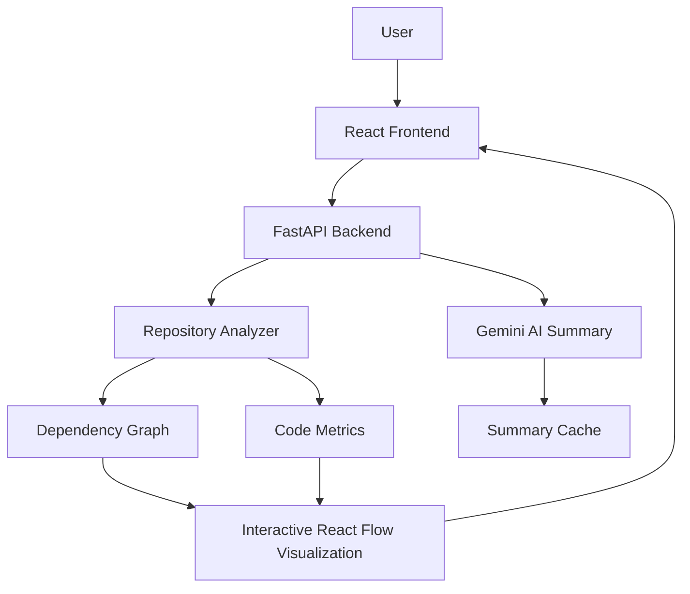

# 🚀 Repository Structure Analysis & Visualization System


A full-stack software architecture analysis platform that analyzes local and GitHub repositories, visualizes file dependencies, calculates code metrics, and generates AI-powered code summaries using Google Gemini.

## 📌 Overview

Understanding an unfamiliar codebase can be challenging, especially when a repository contains many interconnected files.

The **Repository Structure Analysis & Visualization System** helps developers explore software architecture through interactive dependency graphs, code metrics, and AI-generated file summaries.

### ✨ Key Features

- **Repository Analysis:** Analyze local repositories and public GitHub repositories.
- **Dependency Visualization:** Explore file relationships through an interactive React Flow graph.
- **Code Metrics:** View lines of code (LOC) and complexity estimates.
- **AI-Powered Summaries:** Generate file-level explanations using the Gemini API.
- **Summary Caching:** Reuse cached summaries to reduce redundant AI requests.
- **Multi-Language Support:** Analyze supported Python, JavaScript, TypeScript, Java, C, and C++ files.
- **Interactive Exploration:** Inspect file nodes and navigate repository dependencies.
- **Theme Support:** Switch between light and dark themes.

## 🏗️ System Architecture

The application follows a frontend-backend architecture.



## ⚙️ Technology Stack

| Technology | Purpose |
|---|---|
| Python | Backend logic and repository analysis |
| FastAPI | REST API |
| React | Frontend interface |
| React Flow | Interactive dependency graph |
| Axios | Frontend API requests |
| Google Gemini API | AI-powered file summaries |
| GitPython | Git repository operations |

## 🔄 How It Works

1. The user provides a public GitHub repository URL or a local repository.
2. The backend retrieves and analyzes the repository.
3. Source files and dependency relationships are extracted.
4. Code metrics are calculated.
5. The backend returns graph data to the frontend.
6. React Flow displays the repository as an interactive graph.
7. Clicking a file node requests an AI-generated summary.
8. The summary cache helps avoid repeated requests for unchanged files.

## 📊 Code Complexity Analysis

### Python

Cyclomatic complexity is calculated using Radon, if configured in the project.

### Other Supported Languages

For supported languages without dedicated complexity analysis, the application uses heuristic estimates based on decision points such as:

- `if` and `else`
- `for` and `while`
- `switch` and `case`
- `try` and `catch`

These estimates are intended to help compare files; they are not equivalent to a full language-specific static analysis.

## 🧠 AI Summary Caching

To reduce redundant Gemini API calls, the application uses file-based caching.

- File content is hashed.
- Cached summaries can be reused when the corresponding content has not changed.
- New or changed content can trigger summary generation.

```text
CACHE MISS → Generate Summary → Save Cache
CACHE HIT  → Return Cached Summary
```

## 🚀 Installation and Setup

### Prerequisites

Install the following before starting:

- Python
- Node.js and npm
- Git
- A Google Gemini API key

### 1. Clone the Repository

```bash
git clone https://github.com/Muzammil-msk/Repository-Structure-Analysis-and-Visualisation-System.git
cd Repository-Structure-Analysis-and-Visualisation-System
```

> If your project files are inside a nested directory, enter the directory containing `app.py`, `requirements.txt`, and `frontend/` before continuing.

### 2. Set Up the Backend

Create a virtual environment:

```bash
python -m venv .venv
```

Activate it on Windows PowerShell:

```powershell
.\.venv\Scripts\Activate.ps1
```

Install the Python dependencies:

```bash
pip install -r requirements.txt
```

Create a `.env` file in the backend project directory:

```env
GEMINI_API_KEY=your_api_key_here
```

Replace `your_api_key_here` with your own API key. **Never commit your real `.env` file or expose your API key publicly.**

Start the backend:

```bash
python -m uvicorn app:app --reload
```

If your frontend is configured to use port `8001`, start the backend with:

```bash
python -m uvicorn app:app --reload --port 8001
```

### 3. Set Up the Frontend

Open a second terminal and navigate to the frontend directory:

```bash
cd frontend
npm install
npm run dev
```

Open the local URL printed by Vite, usually:

```text
http://localhost:5173
```

### 4. Use the Application

1. Open the frontend in your browser.
2. Enter a public GitHub repository URL.
3. Start repository analysis.
4. Explore the dependency graph and code metrics.
5. Select a file node to request an AI-generated summary.
6. Use the available theme and graph controls to explore the codebase.

## 🧪 Example Repositories

You can test the application with public repositories such as:

- [Axios](https://github.com/axios/axios)
- [GoogleTest](https://github.com/google/googletest)
- [Flask](https://github.com/pallets/flask)

## 🔮 Future Improvements

- Repository-level AI summaries
- Advanced search and filtering
- Export dependency graphs to PNG or PDF
- Automatic graph layout algorithms
- Expanded language support
- Additional code quality and architecture metrics

## 👨‍💻 Author

**Muzammil Shaik**

GitHub: [@Muzammil-msk](https://github.com/Muzammil-msk)

---

If you find this project useful, consider giving the repository a ⭐ on GitHub.
