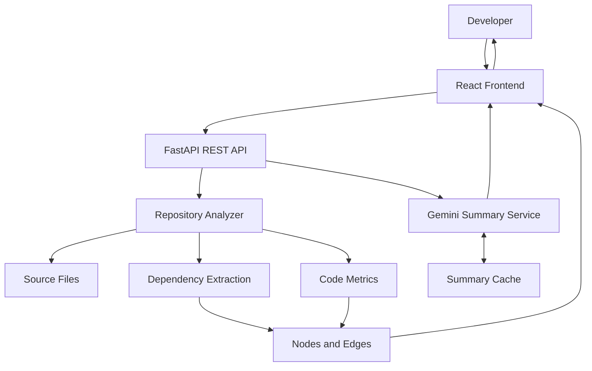

# 🚀 Repository Structure Analysis & Visualization System

<p align="center">
  <strong>Understand any codebase through interactive dependency graphs, code metrics, and AI-powered insights.</strong>
</p>

<p align="center">
  
  
  
  
  
</p>

<p align="center">
  <a href="https://github.com/Muzammil-msk/Repository-Structure-Analysis-and-Visualisation-System">Repository</a> •
  <a href="#-features">Features</a> •
  <a href="#-architecture">Architecture</a> •
  <a href="#-getting-started">Getting Started</a> •
  <a href="#-author">Author</a>
</p>

---

## 📌 Overview

Understanding an unfamiliar codebase can be difficult. Files depend on one another, business logic is distributed across modules, and navigating a large repository manually takes time.

**Repository Structure Analysis & Visualization System** is a full-stack developer tool that analyzes local and public GitHub repositories, extracts file dependencies, calculates code metrics, and visualizes software structure as an interactive graph.

It also integrates Google's Gemini API to generate AI-powered file summaries, helping developers understand what individual files do without having to read every line of code first.

### 🎯 Why this project?

The system brings several repository-understanding capabilities into one interface:

- **Explore architecture:** Discover relationships between files.
- **Understand dependencies:** Visualize how modules connect.
- **Inspect code metrics:** Examine lines of code and complexity estimates.
- **Understand files faster:** Request AI-generated file summaries.
- **Reduce repeated AI calls:** Reuse cached summaries where applicable.

## ✨ Features

### 📂 Repository Analysis

- Analyze public GitHub repositories.
- Analyze local repositories, where supported by the configured backend.
- Retrieve and inspect repository source files.
- Extract file-level dependency relationships.

### 🕸️ Interactive Dependency Visualization

- Visualize repository structure as a node-and-edge graph.
- Explore connections between files.
- Move around the graph and inspect individual nodes.
- Use React Flow for interactive graph rendering.
- Identify complex files using code-metric information.

### 📊 Code Metrics

- **Lines of Code (LOC):** Measure file size.
- **Cyclomatic Complexity:** Analyze Python code when the Radon integration is available.
- **Heuristic Complexity Estimates:** Estimate complexity for supported non-Python languages.
- **Repository Statistics:** Examine extracted codebase information.

> Complexity estimates for languages analyzed with heuristics are approximations, not substitutes for complete language-specific static analysis.

### 🤖 AI-Powered Code Summaries

- Generate file-level explanations using Google Gemini.
- Request summaries by selecting a file node.
- Understand a file's likely purpose and implementation more quickly.
- Cache summaries to avoid unnecessary repeat requests when the cache considers the file unchanged.

### 🌐 Multi-Language Analysis

The analyzer is designed to support files in the following formats, depending on the implemented parser and available analysis rules:

| Language | File extensions |
|---|---|
| Python | `.py` |
| Jupyter Notebook | `.ipynb` |
| JavaScript | `.js` |
| React / JSX | `.jsx` |
| TypeScript | `.ts` |
| TypeScript JSX | `.tsx` |
| Java | `.java` |
| C | `.c` |
| C++ | `.cpp`, `.hpp`, `.h` |

### 🎨 Developer Experience

- Interactive repository exploration.
- File-level inspection.
- Light and dark themes.
- Graph-based architecture navigation.
- A React frontend backed by a FastAPI REST API.

## 🏗️ Architecture

The project separates the user interface, repository analysis, graph data, and AI summarization responsibilities.



### 🔄 Analysis Workflow

1. The developer submits a repository URL or local repository path.
2. The backend obtains the source files using the configured repository workflow.
3. The analyzer inspects supported files and extracts dependencies.
4. Code metrics are calculated where supported.
5. The backend returns graph data to the frontend.
6. React Flow renders the repository as an interactive dependency graph.
7. The developer selects a file to request an AI-generated summary.
8. The summary service checks its cache and generates a new summary when needed.

## 🧰 Technology Stack

| Technology | Role |
|---|---|
| Python | Backend logic and repository analysis |
| FastAPI | REST API |
| React | User interface |
| React Flow (`@xyflow/react`) | Interactive dependency graph |
| JavaScript / JSX | Frontend development |
| Axios | HTTP communication |
| Google Gemini API | AI-powered code summaries |
| GitPython | Git repository operations |
| Radon, if configured | Python complexity analysis |

## 🛠️ Getting Started

Follow these steps to run the project locally on Windows, Linux, or macOS.

### Prerequisites

Install the following:

- Python and pip
- Node.js and npm
- Git
- A Google Gemini API key for AI summarization

### 1. Clone the repository

```bash
git clone https://github.com/Muzammil-msk/Repository-Structure-Analysis-and-Visualisation-System.git

cd Repository-Structure-Analysis-and-Visualisation-System
```

**Important:** Run the following commands from the directory containing `app.py`, `analyzer.py`, `requirements.txt`, and the `frontend/` folder. If the repository has a nested project directory, enter that directory first.

### 2. Configure the backend

Create a Python virtual environment:

```bash
python -m venv .venv
```

Activate it.

**Windows PowerShell**

```powershell
.\.venv\Scripts\Activate.ps1
```

**Windows Command Prompt**

```bat
.venv\Scripts\activate.bat
```

**Linux / macOS**

```bash
source .venv/bin/activate
```

Install the backend dependencies:

```bash
pip install -r requirements.txt
```

Create a `.env` file in the backend project directory:

```env
GEMINI_API_KEY=your_gemini_api_key_here
```

Replace the placeholder with your own key.

> 🔐 **Security:** Never commit your actual `.env` file, API key, or other credentials. Keep `.env` excluded using `.gitignore`.

Start the backend:

```bash
python -m uvicorn app:app --reload
```

If your frontend is configured to call port `8001`, start the backend on that port instead:

```bash
python -m uvicorn app:app --reload --port 8001
```

Use the port expected by your frontend configuration.

### 3. Configure the frontend

Open a second terminal in the project directory:

```bash
cd frontend
npm install
npm run dev
```

Vite will display the frontend URL in the terminal. It is commonly:

```text
http://localhost:5173
```

Open that URL in your browser.

### 4. Analyze a repository

1. Open the application in your browser.
2. Enter a public GitHub repository URL.
3. Start the repository analysis.
4. Explore the generated dependency graph.
5. Select file nodes to inspect available metrics and request AI summaries.
6. Use the available graph controls and theme settings.

## 🧠 AI Summary Caching

AI summarization can require external API requests. The project uses a summary cache to reduce unnecessary repeated generation.

Conceptually:

```text
                  ┌──────────────────┐
                  │  Request Summary │
                  └────────┬─────────┘
                           │
                  ┌────────▼─────────┐
                  │   Check Cache    │
                  └────────┬─────────┘
                           │
                 ┌─────────▼─────────┐
                 │   Cache Found?    │
                 └──────┬───────┬────┘
                        │       │
                       Yes      No
                        │       │
                ┌───────▼──┐ ┌──▼─────────────┐
                │ Use Cache│ │ Call Gemini API│
                └───────┬──┘ └──┬─────────────┘
                        │       │
                        │   ┌───▼──────────┐
                        │   │ Save Summary │
                        │   └───┬──────────┘
                        └───────┤
                                ▼
                       Return File Summary
```

The cache implementation determines when an existing summary can be reused. Cache invalidation behavior depends on the file identity and hashing logic implemented by the backend.

## 📁 Project Structure

The main project files are organized as follows:

```text
Repository-Structure-Analysis-and-Visualisation-System/
├── app.py
├── analyzer.py
├── requirements.txt
├── test_gemini.py
├── .gitignore
├── README.md
└── frontend/
    ├── public/
    ├── src/
    │   ├── components/
    │   │   ├── FileNode.jsx
    │   │   └── GraphToolbar.jsx
    │   ├── App.jsx
    │   ├── App.css
    │   └── index.css
    ├── package.json
    ├── package-lock.json
    └── vite.config.js
```

*The tree illustrates the main files and components visible in the current project. Additional files may exist in your local checkout.*

## 🧪 Example Repositories

Try analyzing public repositories such as:

- [Axios](https://github.com/axios/axios) — JavaScript HTTP client.
- [Flask](https://github.com/pallets/flask) — Python web framework.
- [GoogleTest](https://github.com/google/googletest) — C++ testing framework.

Analysis results depend on the file types, repository structure, and parser support.

## 🔮 Future Improvements

Potential directions for further development include:

- Repository-level AI summaries.
- Advanced file search and filtering.
- Export dependency graphs as PNG or PDF.
- Automatic graph layout algorithms.
- Expanded language-specific parsers.
- Architecture metrics and dependency-cycle detection.
- Automated tests and CI integration.
- Deployment with a production-ready configuration.

## 👨‍💻 Author

**Muzammil Shaik**

GitHub: [@Muzammil-msk](https://github.com/Muzammil-msk)

## ⭐ Support

If you find this project interesting, consider starring the repository on GitHub.

---

<p align="center">
  Built to make codebases easier to explore, understand, and maintain.
</p>
