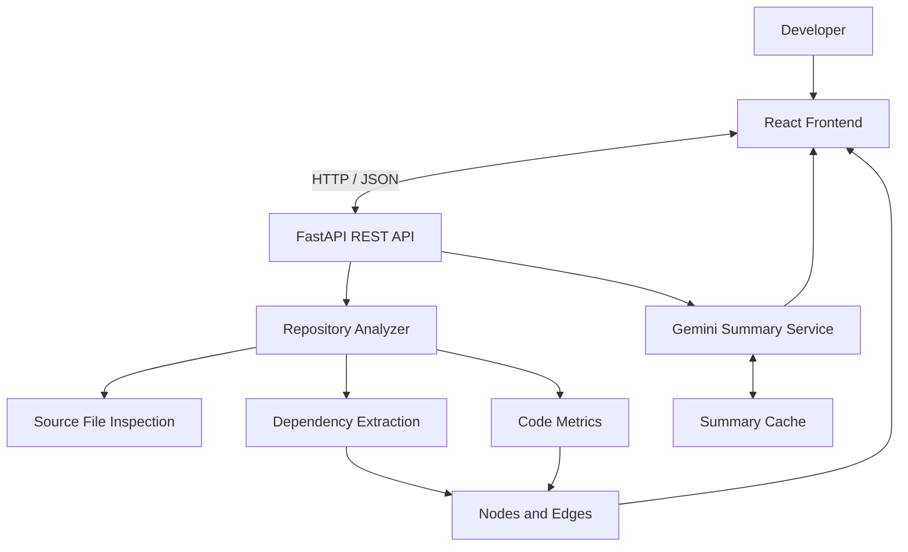

# 🚀 Repository Structure Analysis & Visualization System

<p align="center">
  <strong>Explore codebases. Visualize dependencies. Understand software architecture with AI.</strong>
</p>

<p align="center">
  
  
  
  
  
</p>

<p align="center">
  <a href="https://github.com/Muzammil-msk/Repository-Structure-Analysis-and-Visualisation-System">GitHub Repository</a> •
  <a href="#-features">Features</a> •
  <a href="#-architecture">Architecture</a> •
  <a href="#-installation">Installation</a> •
  <a href="#-author">Author</a>
</p>

---

## 📌 Overview

Understanding an unfamiliar codebase can be time-consuming. Dependencies are scattered across files, important logic is buried in implementation details, and repository structure is not always easy to understand from a file explorer alone.

**Repository Structure Analysis & Visualization System** is a full-stack developer tool that analyzes repositories, extracts file dependencies, calculates code metrics, and transforms codebase structure into an interactive graph.

Integrated with Google's Gemini API, the system can also generate AI-powered explanations of individual files, helping developers explore unfamiliar projects more efficiently.

### 🎯 The Problem It Solves

Developers often need to answer questions such as:

- Which files depend on one another?
- How is a repository organized?
- Which files are potentially more complex?
- What is the purpose of a particular source file?
- How can I explore an unfamiliar project without reading every file manually?

This project brings dependency visualization, code metrics, and AI-assisted file understanding into a single interface.

## ✨ Features

### 📂 Repository Analysis
- Analyze public GitHub repositories.
- Analyze local repositories where supported by the configured backend.
- Inspect supported source files.
- Extract file-level dependency relationships.

### 🕸️ Interactive Dependency Graph
- Represent files as graph nodes and dependencies as edges.
- Explore relationships between source files.
- Navigate and inspect repository architecture visually.
- Use React Flow for interactive graph rendering.
- Present code metrics within the repository exploration workflow.

### 📊 Code Metrics
- **Lines of Code (LOC):** Understand the size of source files.
- **Cyclomatic Complexity:** Analyze Python complexity when the Radon integration is available.
- **Heuristic Complexity Estimates:** Estimate complexity for supported languages using decision-point patterns.
- **Repository Statistics:** Inspect information extracted during analysis.

### 🤖 AI-Powered File Summaries
- Generate file-level explanations using the Google Gemini API.
- Request summaries through the file-node interaction.
- Understand the purpose and structure of unfamiliar source files.
- Cache summaries to reduce redundant AI requests when cached content remains valid.

### 🌐 Multi-Language Analysis

The analyzer is designed to support the following file types, depending on the parser and analysis rules implemented:

| Language | Extensions |
|---|---|
| Python | `.py` |
| Jupyter Notebook | `.ipynb` |
| JavaScript | `.js` |
| React / JSX | `.jsx` |
| TypeScript | `.ts` |
| TypeScript JSX | `.tsx` |
| Java | `.java` |
| C | `.c` |
| C++ | `.cpp`, `.hpp`, `.h` |

### 🎨 Developer Experience
- Interactive graph exploration.
- File-level inspection.
- Light and dark themes.
- Search, navigation, and graph controls where implemented.
- Separation of frontend and backend responsibilities.

## 🏗️ Architecture

The application uses a React frontend and a Python FastAPI backend. The backend analyzes repositories and produces graph data, while the Gemini integration provides AI-generated file summaries.



## 🔄 How It Works

1. The user submits a repository URL or a supported local repository path.
2. The backend obtains the source files through the configured repository workflow.
3. The analyzer inspects supported files and extracts dependency relationships.
4. Code metrics are calculated where supported.
5. The backend returns graph data through the REST API.
6. The React frontend renders the graph using React Flow.
7. The user selects a file to request an AI-generated summary.
8. The summary service checks the cache and generates a new summary when needed.

## 🧰 Technology Stack

| Technology | Purpose |
|---|---|
| Python | Backend logic and repository analysis |
| FastAPI | REST API and request handling |
| React | Frontend user interface |
| React Flow (`@xyflow/react`) | Interactive graph visualization |
| JavaScript / JSX | Frontend development |
| Axios | HTTP communication |
| Google Gemini API | AI-powered code summaries |
| GitPython | Git repository operations |
| Radon, if configured | Python complexity analysis |

## 🧠 AI Summary Caching

AI summarization may require external API requests. The summary cache helps reduce repeated generation for files whose cached content is still valid.

```text
                Request File Summary
                         |
                         v
                    Check Cache
                         |
                +--------+--------+
                |                 |
             Cache Hit         Cache Miss
                |                 |
                v                 v
          Return Cached      Call Gemini API
              Summary             |
                                  v
                            Save Summary
                                  |
                                  v
                            Return Summary
```

The exact cache invalidation behavior depends on the file identity and hashing logic implemented by the backend.

## 🖥️ Installation

### Prerequisites

Install the following tools:

- Python and pip
- Node.js and npm
- Git
- A Google Gemini API key for AI summarization

### 1. Clone the Repository

```bash
git clone https://github.com/Muzammil-msk/Repository-Structure-Analysis-and-Visualisation-System.git

cd Repository-Structure-Analysis-and-Visualisation-System
```

If the repository contains a nested project directory, enter the directory containing `app.py`, `analyzer.py`, `requirements.txt`, and `frontend/` before continuing.

### 2. Configure the Backend

Create a virtual environment:

```bash
python -m venv .venv
```

Activate it.

**Windows PowerShell**

```powershell
.\.venv\Scripts\Activate.ps1
```

**Windows Command Prompt**

```bat
.venv\Scripts\activate.bat
```

**Linux / macOS**

```bash
source .venv/bin/activate
```

Install dependencies:

```bash
pip install -r requirements.txt
```

Create a `.env` file in the backend project directory:

```env
GEMINI_API_KEY=your_gemini_api_key_here
```

Replace the placeholder with your own API key.

> 🔐 **Security:** Never commit your real `.env` file, API keys, or credentials. Keep `.env` excluded through `.gitignore`.

Start the backend:

```bash
python -m uvicorn app:app --reload
```

If your frontend is configured to use port `8001`, start the backend with:

```bash
python -m uvicorn app:app --reload --port 8001
```

Use the port configured in your frontend API requests.

### 3. Configure the Frontend

Open a second terminal from the project directory:

```bash
cd frontend
npm install
npm run dev
```

Open the URL displayed by Vite, usually:

```text
http://localhost:5173
```

### 4. Use the Application

1. Open the frontend in your browser.
2. Enter a public GitHub repository URL.
3. Start the repository analysis.
4. Explore the generated dependency graph.
5. Select file nodes to inspect available metrics and request AI summaries.
6. Use the available graph controls and theme settings.

## 🧪 Example Repositories

Test the analyzer with public repositories such as:

- [Axios](https://github.com/axios/axios) — JavaScript HTTP client.
- [Flask](https://github.com/pallets/flask) — Python web framework.
- [GoogleTest](https://github.com/google/googletest) — C++ testing framework.

Analysis results depend on repository structure, supported file types, and implemented parsing rules.

## 🔮 Future Improvements

Potential directions for further development:

- Repository-level AI summaries.
- Advanced file search and filtering.
- Export dependency graphs as PNG or PDF.
- Automatic graph layout algorithms.
- Expanded language-specific parsing.
- Dependency-cycle detection and architecture insights.
- Automated testing and continuous integration.
- Production deployment and monitoring.

## 👨‍💻 Author

**Muzammil Shaik**

GitHub: [@Muzammil-msk](https://github.com/Muzammil-msk)

## ⭐ Support

If you find this project useful, consider giving the repository a star.

---

<p align="center">
  Built to make codebases easier to explore, understand, and maintain.
</p>