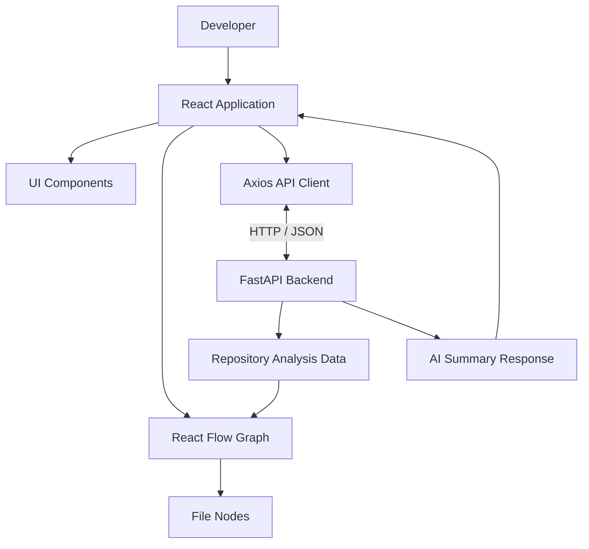

# 🎨 Repository Visualization — Frontend

<p align="center">
  <strong>An interactive React interface for exploring repository structure, file dependencies, and code insights.</strong>
</p>

<p align="center">
  
  
  
  
</p>

<p align="center">
  <a href="../README.md">Main Project README</a> •
  <a href="#-features">Features</a> •
  <a href="#-getting-started">Getting Started</a> •
  <a href="#-project-structure">Project Structure</a>
</p>

---

## 📌 Overview

The frontend is the interactive user interface of the **Repository Structure Analysis & Visualization System**.

Built with React and Vite, it communicates with a FastAPI backend to display repository analysis results as an interactive dependency graph. Developers can explore file relationships, inspect nodes, and request AI-generated file summaries through the application's interface.

The frontend is designed to make complex repository structures easier to navigate and understand.

## ✨ Features

### 🕸️ Interactive Dependency Graph
- Visualize files and their dependencies using React Flow.
- Explore graph nodes and connections.
- Interact with the repository graph using the available navigation controls.
- Display file information supplied by the backend.

### 📊 Code Insights
- Present available code metrics such as lines of code and complexity.
- Help users identify files that may need closer inspection.
- Connect graph exploration with file-level information.

### 🤖 AI Summary Integration
- Request file summaries through the backend API.
- Display the summary returned by the AI summarization service.
- Support the backend's caching behavior without exposing API credentials in the frontend.

### 🎨 User Experience
- Light and dark themes, where configured.
- Reusable React components.
- Interactive file nodes and graph toolbar.
- Responsive development workflow through Vite's development server.

## 🧰 Technology Stack

| Technology | Purpose |
|---|---|
| React | Component-based user interface |
| Vite | Development server and build tooling |
| React Flow (`@xyflow/react`) | Interactive graph visualization |
| Axios | HTTP requests to the FastAPI backend |
| JavaScript / JSX | Frontend application logic |
| CSS | Layout, styling, and themes |
| npm | Dependency management |

## 🏗️ Frontend Architecture



The React application manages the interface and graph interactions, while repository analysis and AI summarization are handled by the backend.

## 📁 Project Structure

```text
frontend/
├── public/
├── src/
│   ├── components/
│   │   ├── FileNode.jsx
│   │   └── GraphToolbar.jsx
│   ├── App.jsx
│   ├── App.css
│   └── index.css
├── .gitignore
├── index.html
├── package.json
├── package-lock.json
├── vite.config.js
└── README.md
```

**Key files**

- `src/App.jsx` — Main application interface and frontend behavior.
- `src/App.css` — Application-specific styles.
- `src/index.css` — Global styles and theme foundations.
- `src/components/FileNode.jsx` — Reusable file-node UI.
- `src/components/GraphToolbar.jsx` — Graph toolbar controls.
- `package.json` — Dependencies and npm scripts.
- `vite.config.js` — Vite configuration.

The structure above reflects the main files in the current project; additional files may exist in your working